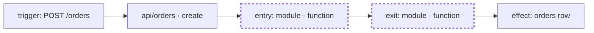
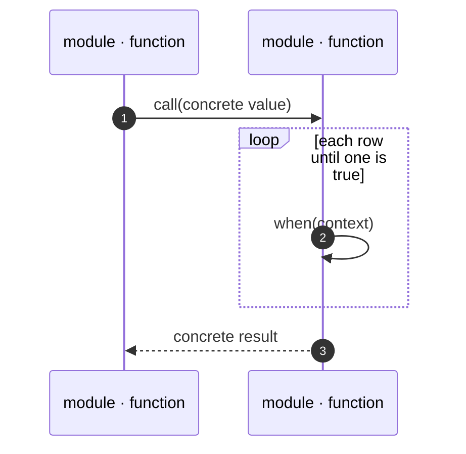

# Walk report shape

## Template

````md
# Walk: <behavior, one line>

When `<input>` enters at `<entry module · function>`, how does it become `<output>` at `<exit module · function>`?
Commit: `<short sha>` (+ uncommitted changes: yes | no). Pinned: <clock, seed, flags | none>.
Values: real (from <source>) | simulated (<n> of <m> values; why the code cannot run).

## Where you are



- **Workline:** <one sentence: what this chain does for the product>.
- **Walked segment:** <entry> → <exit>. <One sentence: its job inside the workline.>
- **Downstream risk:** <what a person sees when this segment is wrong>.
- Other triggers: <names, or "none">.

## Case 1 — <short name> (`<the concrete input>`)

### ① `path/file.ts · functionName`

```text
in:    <names and values that enter>
out:   <names and values that leave>
state: <only the outside state that changed>
```

<One to three ASD-STE100 sentences: what occurs here, and why.>

### ② `path/file.ts · otherFunction`

…

### ③ back to ② (pass 2 of 30)

…

## Case 2 — …

## Summary

### Sequence



### Cases

| Case | Input | Exit | Result |
| --- | --- | --- | --- |

### Possible bugs

- **<short title>.** Trigger: `<value>`. At step <case.step>: <what goes wrong>. Confidence: seen | suspected.

`seen` means a walk value shows the wrong result. `suspected` means the code reads wrong, but no walk value shows it yet.
````

## Rules for the map

- Draw one straight line from the trigger to the effect. Mark only the walked nodes with `class … walked`.
- Label an async hop edge with its channel: `-- "queue: order-created" -->`.
- Label each node `module · function`. Prefix the first node with `trigger:` and the last with `effect:`.
- Use the same `module · function` names as the breakpoint headings, so the reader can find each breakpoint on the map.

## Rules for the values block

- Keep at most 5 lines per block. Shorten long arrays as `[first, second, … 28 more]`.
- Write `state` only when outside state changes. Show the full state after the change: `applied = { 1042: "CouponPercent" }`.
- Keep code names, values, and error text as they are in the code and the output.

## ASD-STE100 for the notes

- One idea in each sentence. Write at most 20 words in a procedure sentence and 25 words in a description sentence.
- Use the active voice and the present tense: "The wrapper records the row name."
- Use simple, common words. Use one word for one meaning in all of the report. For example, if you write "row", then always write "row".
- Use a maximum of 3 nouns in a noun cluster.
- Start a warning with the risk: "Risk: the map grows when …".

## Execution view

[EXECUTION.html](EXECUTION.html) draws the walk like an AWS Step Functions execution: a graph of states, Input / Output / State / Note for each state, and an event history. Its `#walk-data` JSON holds a full example. Map the report to it:

| Report | JSON |
| --- | --- |
| Header: commit, pinned values, value source | `commit`, `pinned`, `values` (`"real"` or `"simulated"`), `valuesNote` |
| "Where you are" | `workline.nodes[]` (`label`, `walked`), `purpose`, `segment`, `risk`, `others` |
| A case | `cases[]`: `name`, `input`, `exit`, `result`, `status` (`"ok"` or `"fail"`) |
| A breakpoint | `states[]`: `name`, `type`, `fn` (`path/file · function`), `ms`, `in`, `out`, `state`, `note` |
| A decision | `type: "Choice"`, `arm` (the arm taken), `ghost` (the arm not taken) |
| A loop | `type: "Map"`, `iter` (`"11 passes, all false"`) |
| The step where a case fails | `status: "fail"`; a last step that only catches is `type: "Fail"` |
| Possible bugs | `bugs[]`: `title`, `trigger`, `at` (`case.step`), `what`, `conf` |

- `in`, `out`, and `state` are the values blocks as JSON, with the same values and the same 5-line limit.
- `ms` comes from the run. For a simulated walk, write `0`.
- In a JSON string, write `<\/` in place of `</`, so the page script does not end early.

## Example breakpoint

### ② `scripts/pricing-trace/rule-recorder.ts · rule.when (wrapper)`

```text
in:    order_id = 1042, rule = CouponPercent (index 11)
out:   true
state: applied = { 1042: "CouponPercent" }
```

The old `when` returns `true`. The wrapper records the rule name for this order. `find` stops, so rules 12–29 do not run.
